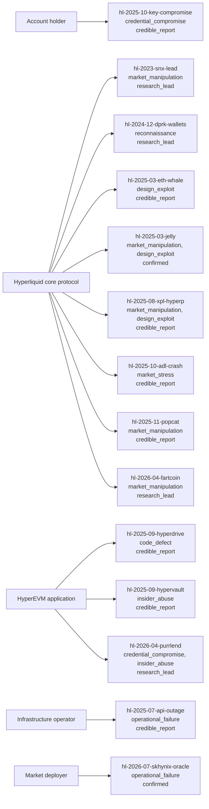

<!-- Generated by `hyperliquid-security report`. Do not edit by hand. -->

# Incidents by control owner

Each incident hangs off the party whose control failed; its mechanisms and derived tier are on the node. Two axes, not one bucket: JELLY is market manipulation (mechanism) against a core-protocol design (owner).

